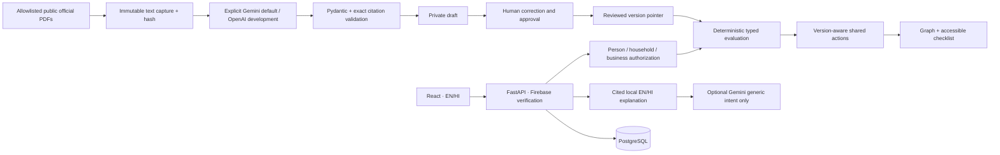

# Architecture overview

One monorepo, independent React/Vite web and FastAPI deployables. PostgreSQL holds explicit subjects, facts, evidence pointers, source snapshots, draft/review history, immutable published requirements, evaluation snapshots and reusable actions. Firebase verifies identity; backend database membership/guardian grants determine object permissions.

Gemini remains the extraction default. Explicit OpenAI configuration never falls back automatically. Provider/model/hash/version/usage diagnostics are retained. Manual Post-Matric curation is separately identified and reuses captured public pages without claiming a new fetch or model generation.

Guardians need both active dated relationship and unrevoked grant. Business roles are checked server-side. Household facts are never inferred by summing members. Fresh/renewal is per opportunity, not a global profile attribute. User-supplied facts cannot verify documents. Simulations save nothing.

Planned production: Firebase Hosting → Cloud Run → Cloud SQL. Cloud Run Jobs/Scheduler and GCS binary archives remain future integration work. No cloud provisioning/deployment occurred. See `infra/README.md` for the approval-gated procedure.
