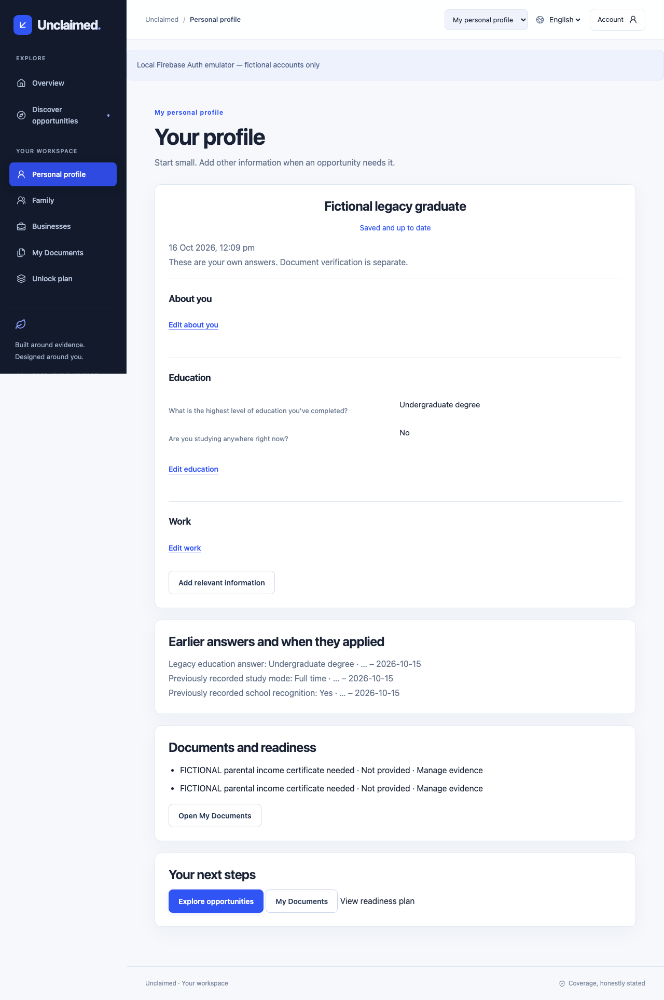

# Common Sense final report — 16 October 2026

**Graduate + not currently studying is valid.** The reproduced failure was old active study-mode/school answers hidden by the questionnaire. A generic conflict message made the completed-degree answer appear wrong. The actual browser/FastAPI/PostgreSQL reproduction and subsequent correction are documented in [the audit](common-sense-audit.md).

## What changed

- Separate **Are you studying anywhere right now?**, **What are you currently studying?**, and **What is the highest level of education you've completed?** Current mode/school questions only appear where applicable. School includes below Class IX; employment and completed qualifications do not restrict course choices.
- Keep legacy `education_level` unchanged and explicitly ambiguous. Do not infer a degree award or enrollment from it. The user can add precise answers and explicitly archive the old answer into dated history. No real saved profile was migrated or edited by this task.
- A backend-owned shared semantic specification identifies field references, values, active periods, severity and EN/HI explanations. Nineteen positive/negative/ambiguous cases run in both Python and the actual browser. New contradictions block with precise explanations; unchanged legacy conflicts are visible warnings, not hidden save traps.
- End-date saved current-study answers only after confirmation; retain previous values/context in history. Cancel preserves them. New unsaved corrections can be cleared with confirmation without inventing a past date. Current summaries exclude historical answers; the separate history section uses previous-period labels.
- Distinguish invalid value/date, semantic conflict, stale edit, subject/session denial, network/database and document storage failures. Two-tab stale edits return 409 with a different explanation and preserve the draft; controlled reload requires a deliberate choice. Missing legacy metadata no longer crashes the age summary.
- Current-course/mode evaluation depends on current enrollment; school recognition additionally needs a current school course. Missing/expired/conflicting information stays unknown. Explicit not-enrolled is a substantive failure for an explicitly current-study source condition, not a reason to reject completed education. Ambiguous legacy source mappings stay unknown for admin clarification. New extraction guidance uses the precise keys; no extractor was called live.
- Income scope/period filtering occurs **before** conflict detection. Zero remains known; missing assessment period stays unknown. Independently verified certificate facts must match any explicitly required income period/definition; user possession or a different-period certificate remains unknown. Household income is never guessed from members or parental income.
- Normalize supported Indian nationality aliases so `IN` and “Indian” compare consistently. Legacy Other is unspecified; plain-language nationality can be clarified independently of residence/domicile. Supported Hindi/English names for Rajasthan, Dausa, Delhi, Maharashtra and Pune compare consistently within the same location dimension; unmapped cross-language spellings remain unknown. This does not claim complete nationality/geographic alias coverage.
- An assessment with only not-applicable conditions stays uncertain; renewal-only rules on a fresh application cannot manufacture a potential match. Selection/administrative conditions remain distinct from entitlement.
- Separate optional business registration geography/activity from operating geography/structure. Structure can be unknown; registration/turnover are not inferred. Existing fact dates survive unrelated business edits; editing a historical personal answer’s date preserves its value. New business facts cannot be submitted as personal/dependent facts.
- Evaluator version/fingerprint advances to **4**, includes implicit enrollment dependencies and preserves earlier assessments. No database DDL migration or automatic fact backfill is required: new allowlisted keys use existing string/JSON storage. Generated API/TypeScript contracts stay authoritative. Hosting revalidation configuration is prepared; no hosted deployment/cache acceptance is claimed.

## Scenario-driven validation

See the [44-scenario matrix and fact/relationship inventory](domain-semantics-matrix.md) for every required example, temporal meaning, old/correct behavior, clarification and test references.

The real local browser suite uses the official Firebase **Auth emulator**, actual FastAPI token verification/routes, random isolated PostgreSQL schemas and private temporary file storage. It exercises:

1. Shared specification parity for nineteen valid/invalid/ambiguous cases.
2. Legacy graduate/nonstudent recovery, exact visible prior values, independent completed-degree save/reload and explicit history preservation, in English/Hindi.
3. Current postgraduate study versus completed undergraduate qualification; cancel/accept status changes, preserve history, and edit completed education independently.
4. Fictional published current-course source → exact enrollment question/citation → exact current-course question → save/re-evaluate; ending enrollment prevents historical course from satisfying it.
5. Registered business in Maharashtra operating in Rajasthan, independent current activity, unknown turnover and personal-context separation.
6. Existing actual private PDF upload/shared links/download/replace/delete, while evidence remains unverified.
7. Guardian/dependent/business isolation, cross-account denial and revocation.
8. Interrupted transport/upload refresh/retry and failed-save recovery with actual successful persistence.
9. Actual two-tab stale revision and disabled duplicate pending save.

## Executed commands and evidence levels

| Command | Observed result / evidence level |
|---|---|
| Baseline reproduction | 1 actual local browser test passed, reproducing hidden fields and disabled save; 4.2 s |
| `make contracts` | OpenAPI, TypeScript and shared semantic specification regenerated |
| `make preflight` | Configuration ready; values withheld; no model/auth provider probe; local fictional uploads enabled, production uploads-ready=false |
| `make check` | Ruff check/format, **155 passed / 1 skipped**, Alembic no drift; ESLint, TypeScript and Vite build passed |
| `make test-e2e` | **29 passed** public/mocked authenticated contracts; final ordinary browser run 17.8 s |
| `make test-product-e2e` | **9 passed** actual local emulator/API/PostgreSQL/files; 14.9 s, including historical date-restoration assertion |
| `make finale-demo ARGS=--run-isolated` | **8 passed**, 2.25 s; isolated public-candidate copies and fictional version-change scenarios |
| Frontend final lint/type/format/build | Passed after current/history and historical-date preservation changes; Vite's >500 kB main-chunk warning retained |
| Saved data/source audit and teardown | Read-only real draft/citation audit; automatic teardown verified at zero product-test schemas/temp file directories |

Counts overlap: shared cases and focused backend tests are within the 155; finale reruns selected integration cases. The skipped test is opt-in live official-source fetching. Seven backend warnings are dependency/test deprecations, not hidden failures. Mocked source/provider tests do not establish current Gemini/OpenAI availability. No actual Google OAuth or hosted public acceptance was performed; emulator authentication is reported separately.

Local logs: `/tmp/common-baseline.log`, `/tmp/common-check.log`, `/tmp/common-browser-final.log`, `/tmp/common-browser-demo.log`, `/tmp/common-real-final.log`, `/tmp/common-build-final.log`, `/tmp/common-format.log`, `/tmp/common-source-after.log`. Earlier failing regressions were repaired: new fixture required a review timestamp; absent age metadata needed a safe fallback; the unregistered-business contract now explicitly chooses that structure instead of relying on a misleading default. No substantive acceptance assertions were removed.

## Legacy clarification and remaining limits

Read-only aggregate inspection found **one stored legacy education answer** (and one each student/mode/school answer), with no private identity/value output. It remains unchanged. The user must clarify current study/completed education if needed and explicitly date/archive old answers; the application does not assume which old answer meant what. Any reviewed source rule still using legacy `education_level` needs administrator source-backed correction before it can decide education eligibility. No real draft was corrected or approved automatically.

No DOB/automatic age advancement, multiple simultaneous course model, multiple parallel editable income scopes, complete global nationality alias handling, adult invitation workflow, authoritative document verification or account export/erasure was added. Undated facts remain self-reported assertions whose accuracy users must confirm; there is no fabricated freshness SLA. Explicit expired/future/as-of windows are enforced. Original policy text and some backend error prose remain in source/English language; shared semantic explanations and education questions are EN/HI, not a claim of legal translation certification.

Production sensitive uploads remain blocked until malware scanning/quarantine, private GCS/IAM and security/privacy acceptance. Real Google sign-in, human usability timing and hosted asset/header behavior still need human acceptance. Firebase revalidation config is local preparation only. The final main bundle is 599.78 kB minified (177.95 kB gzip); its size warning is not a performance benchmark. No cloud resources, deployment, paid AI, new official ingestion, real publication or Git push occurred.

Both genuine DEPwD drafts remain unchanged/unpublished with **36 + 34 = 70 citations**, preserved review history and the 61 + 7 captured pages; source hash `32d14860c90b70276d91d12eb4e23d8f2eed4851c9f2798b103d060f93214446`. No normal-database profile/document writes were made by this task.

## Visual evidence and local commits

Fictional screenshots are committed under `docs/screenshots/common-sense/`: baseline hidden-answer failure, visible legacy clarification, saved graduate/nonstudent, Hindi mobile, independent current/completed education and distinct business geography. All use the actual local emulator/API/database except the baseline is also the same real stack before the fix; none are real user documents/profiles.

Implementation commit `c553fef` records backend semantics/typed contracts and regression cases; `41d9f34` records education-history recovery, source-linked questions and the real-browser harness. `d906b22` records dated-answer preservation, representation safeguards and extractor metadata. `f7b5ea5` records verified-evidence income-scope matching; audit evidence follows in the documentation commit. See `git log` for final identifiers. No push.

[Baseline hidden-answer failure](screenshots/common-sense/common-sense-before-hidden-study.png) · [Visible precise legacy clarification](screenshots/common-sense/common-sense-legacy-clarification-visible.png) · [Hindi mobile](screenshots/common-sense/common-sense-graduate-hi-mobile.png) · [Current postgraduate course with completed undergraduate qualification](screenshots/common-sense/common-sense-current-completed-independent.png) · [Different business registration/operating locations](screenshots/common-sense/common-sense-business-geography.png).
