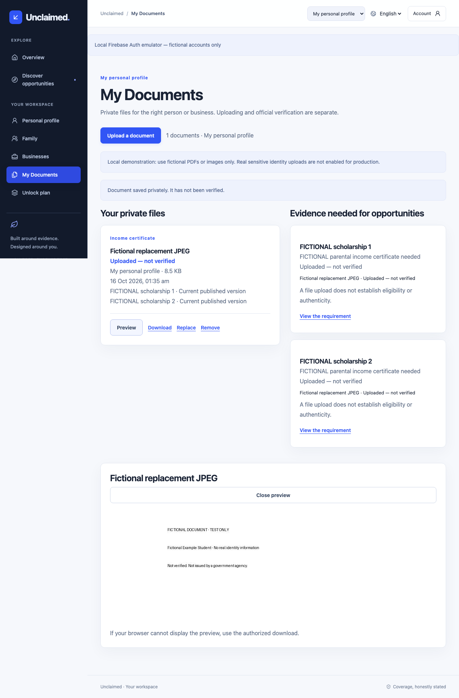

# Product completion report — 16 October 2026

The local product now supports a short guided profile, saved section editing, actual private document lifecycle and connected documentary-readiness journeys for people, managed dependents and businesses. The existing Opportunity OS theme is retained. This is a locally validated release candidate, **not a production-sensitive-upload release or hosted acceptance claim**.

## Answers to the requested acceptance questions

1. **Onboarding effort:** name/nickname is required; interest is optional. General shows two optional questions, work three, education four initially, undergraduate students five, school students six. The final real automated learner run took **666 ms including emulator login**, saved two answers and skipped three optional questions. Automation is not human reading time. Approximately two-minute human completion remains to be timed using the acceptance checklist.
2. **Conditional fields:** interest controls education/work questions; student=yes reveals study mode; only school classes IX–XII reveal school recognition. Income, disability and additional geography appear in relevant edits/source follow-ups, not initial setup. Certificates route to actual files. Existing dated answers show their retained date controls only when applicable.
3. **Contradictions:** current nonstudent/enrolment or school answers, and undergraduate/postgraduate with current school recognition, are prevented. Parent changes ask before clearing dependent answers; historical dated information survives. No DOB field exists, so an age-versus-DOB validator is not claimed. Mismatched income period/definition stays unknown, and document subject permissions are enforced server-side.
4. **Save semantics:** explicit dirty/saving/saved/error/conflict states; unchanged or pending Save is disabled. Success returns to summary. Repeat identical backend saves preserve IDs and avoid audit/re-evaluation churn; changed fields update in place. Current clients send revisions; stale writes return 409 and preserve the draft. Two browser tabs demonstrated winner/conflict/reload; pending inputs and submission were disabled and only one write occurred. Legacy callers without the optional revision remain last-writer compatible.
5. **Returning edits:** saved summary/category edits replace the old wizard restart. Cancel/discard guards and failed-request retry preserve intent; background refetch does not replace unsaved input.
6. **Actual files:** real PDF/JPEG/PNG bytes were stored privately, reloaded, previewed, downloaded byte-for-byte, replaced and removed. Upload failure/reselection after refresh reused one real metadata intent. File format/size, count/byte quota, hashes, expiry, write failure and deletion retry were exercised.
7. **Private permissions:** API tests deny unrelated account/dependent, nonconsenting adult, revoked guardian and removed business membership access; business viewers may read authorized business records but cannot mutate. Real browser users additionally demonstrated cross-account denial, guardian revocation and business/personal separation. Access grants expire, bind user/document/hash/purpose and require fresh subject authorization on retrieval. No private content is sent to AI.
8. **Checklist integration:** direct missing-document links carry subject and exact requirement; the vault links published versions and source evidence. Profile, Family, Business, Detail, evaluations, planner/graph and Settings all lead to the authorized workflow.
9. **Compatible reuse:** one actual PDF was explicitly attached to two compatible fictional scholarships; the graph displayed one action/two connections. Different income periods/definitions, policy scope and publication versions cannot silently share readiness. Filename/hash matching alone grants nothing.
10. **Unknown stays unknown:** documentary readiness becomes uploaded/unverified, while document-rule legal evaluation stays unknown. Uploads never create verified facts, authenticity or government approval. Expired, replaced, removed and not-provided states remain distinct. No fake verification process was added.
11. **Family/business:** household name-first creation leads to overview; dependent creation is separate with guardian confirmation and its own questionnaire/files/plan. Self is labeled separately. Business creation asks a name/type with optional details; registration identifiers/turnover are not forced. Saved editing and permissions preserve subject separation. Adult invitation UI remains deferred.
12. **Real persistence:** four browser journeys used official Firebase Auth emulator tokens, actual FastAPI routes, random PostgreSQL schemas and private temporary local storage. They covered missing age → save/evaluate, scholarship document gap/reuse/graph, preview/download/replace/remove, household/dependent/revocation, unregistered business and recovery/concurrent saves. All fixture records/files were fictional; test schemas/files were removed afterwards.
13. **Mocks:** the 29-test existing browser suite mixes actual public pages with explicitly mocked authenticated API/session contracts. Provider/source-fetch tests mock external services. Storage write/purge failure tests inject failures but successful storage uses real files. In real browser recovery tests only transport interruption/delay is injected; successful upload/download responses come from actual API/storage. The live official fetch test remains skipped. Emulator authentication is distinct from real Google OAuth.
14. **Production gaps:** production uploads are blocked until malware scanning/quarantine/security acceptance. GCS adapter exists without live bucket/IAM acceptance. Real Google popup/hosted CORS, human onboarding timing, adult invitations, full account export/erasure, document authenticity verification, scheduler/alerts and application submission remain incomplete/unavailable. Static EN/HI flows are exercised; authoritative text and some backend messages retain original language. The main bundle remains 582.78 kB minified with Vite's >500 kB warning; no performance benchmark is claimed.
15. **Human approval:** substantively review official rules/amendments before any publication; authorize deployment separately; accept storage/security/privacy controls before real sensitive uploads. No approval/publication, cloud provisioning/deployment, new paid AI call or Git push occurred here.

## Commands and observed results

These counts overlap: the focused suites and isolated demo rerun selected backend tests rather than adding independent coverage totals.

| Command/check | Final observed result |
|---|---|
| `make contracts` | OpenAPI and TypeScript regenerated; contracts synchronized |
| `make preflight` | Configuration ready; current explicit development provider remains OpenAI, local uploads=true, production uploads-ready=false; key values withheld |
| `make check` | Ruff check/format including test server; **123 passed, 1 skipped**, Alembic no drift; ESLint, TypeScript, production build pass |
| New profile/document tests | 6 profile (including two pure validations) + 9 vault cases within full suite; actual PostgreSQL/files for integration cases |
| `make test-e2e` | **29 passed**, 18.1 s; public and mocked authenticated contracts |
| `make test-product-e2e` | **4 passed**, 11.2 s; actual local emulator/API/PostgreSQL/files |
| `make finale-demo ARGS=--run-isolated` | **8 passed**, 2.58 s; disposable public-candidate-copy and fictional change scenarios |
| Clean `apps/web/dist` rebuild | TypeScript + Vite passed; main 582.78 kB, gzip 173.89 kB; chunk warning retained |
| Focused profile capture recheck | **1 passed**, 3.4 s; selected-interest assertion and transition-free screenshot |
| Prettier and isolated server lint | Pass with API-project Ruff context; frontend formatting pass |
| `docker build --no-cache -t opportunity-api:product-completion apps/api` | Passed; non-root image built locally; no deployment |
| Fresh container loopback smoke / existing local API | `/live`, `/health`, `/v1/opportunities` 200; documents/profile/admin private routes 401, document no-store headers correct |
| Production bundle check | No test-login page/password, private-key marker or local DB password found; no claim of exhaustive secret scanning |
| Real saved-source audit | Both drafts unchanged/unpublished, all 70 citations preserved; source hash/pages unchanged |

A final teardown audit found Playwright’s default force-kill and Uvicorn’s signal re-raise prevented cleanup. The product test server now receives an explicit graceful shutdown and completes its outer cleanup before exit. Ten leftover disposable schemas were checked for the exact fictional source and zero real opportunities, then removed with their ten task-owned fictional file directories. The final four-journey run automatically left **zero** product-test schemas and temporary file directories.

Seven backend warnings are existing dependency/test deprecations (Starlette test client, Alembic config, pypdf active-content fixture); no warning is hidden or counted as a failure. The skipped test is the opt-in live official-source fetch. No source was refetched or extracted during this sprint. Normal migration upgraded additively to `e14a7d63f954`; existing application records were not reset.

Execution logs are local `/tmp/product-final-check.log`, `/tmp/product-final-contracts-browser.log`, `/tmp/product-final-real.log`, `/tmp/product-final-browser-demo.log`, `/tmp/product-docker-build.log`, `/tmp/product-clean-web-build.log`, `/tmp/product-final-preflight.log` and `/tmp/product-source-after.log`. The read-only audit also saved `.live-validation/finale-source-audit.json`. Logs contain no provider key/document bytes; screenshots below are fictional examples only.

## Preserved official data

Pre-Matric `9588fed8-1f25-423d-8b5f-890636e68695`: draft, 36 citations, three existing reviews, historical OpenAI extraction metadata retained. Post-Matric `db51eb5b-5972-4d5a-8b13-85144f2f62d5`: draft, 34 citations, one existing review, manual-curation metadata retained. Captured source bundle: 61 + 7 pages; hash `32d14860c90b70276d91d12eb4e23d8f2eed4851c9f2798b103d060f93214446`. Zero real published opportunities. Tests do not populate or publish these records.

## Reviewable screenshots and implementation

[Before reproduction](screenshots/product-completion/product-profile-before.png), [new setup](screenshots/product-completion/product-profile-new-en.png), [incomplete conditional questions](screenshots/product-completion/product-profile-incomplete-en.png), [edited/unsaved](screenshots/product-completion/product-profile-edited-en.png), [saved summary](screenshots/product-completion/product-profile-summary-en.png), [Hindi mobile summary](screenshots/product-completion/product-profile-summary-hi-mobile.png).

[Upload/compatible choices](screenshots/product-completion/product-real-upload-en.png), [Hindi mobile vault](screenshots/product-completion/product-real-vault-hi-mobile.png), [shared evidence graph](screenshots/product-completion/product-real-shared-graph-en.png), [empty family](screenshots/product-completion/product-real-family-empty-en.png), [populated family](screenshots/product-completion/product-real-family-populated-en.png), [empty business](screenshots/product-completion/product-real-business-empty-en.png), [saved business](screenshots/product-completion/product-real-business-overview-en.png), [business-owned file](screenshots/product-completion/product-real-business-document-en.png). Fifteen screenshots are committed, not merely ephemeral test artifacts. The profile contract captures use mocked session/data; the product-real captures use actual emulator/API/database/files.

Implementation commits: `ebb58c4` private lifecycle/stable persistence; `08aabd5` cleanup/quota/concurrent-subject hardening; `665433f` guided profiles, connected vault/subject UX and actual local browser harness. `1f98d81` fixes and verifies graceful test-harness teardown; documentation/screenshots follow in the release-evidence commit. No push.

Read [profile design](profile-ux-redesign.md), [document architecture](document-architecture.md), [full journey audit](product-completion-audit.md) and [human acceptance checklist](real-user-acceptance.md). The normal local app is usable for fictional profiles/files; a complete shared-opportunity demo runs through the isolated harness because the real catalogue correctly remains empty pending human publication review.
